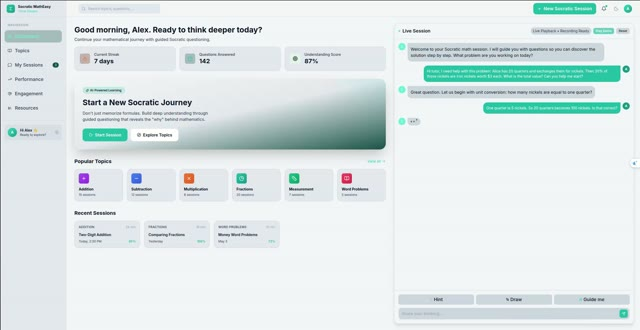
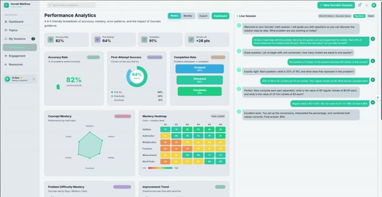

# Graph-CPO: Graph-Grounded Contrastive Pedagogical Optimization for Socratic Question Generation

Implementation of the paper *"Graph-CPO: Graph-Grounded Contrastive Pedagogical
Optimization for Socratic Question Generation"*.

Graph-CPO formulates Socratic sub-question generation for math word problems as a
finite-horizon sequential decision process over a **Semantic Dependency Graph (SDG)**,
and optimizes the question policy with a multi-objective RL method that combines:

- a **graph-grounded contrastive relevance reward** (align each question to the current
  frontier node, penalize repetition of resolved nodes),
- **independently normalized reward dimensions** with **curriculum weighting**
  (preventing easy objectives such as format adherence from dominating — i.e., reward
  collapse), and
- a **targeted supervised warm start** conditioned on graph action frames.

## Demos

Demos of **Socratic MathBuddy**, the application we are building on top of Graph-CPO.
Click a thumbnail to play the video:

| Socratic tutoring session | Performance & engagement analytics |
|---|---|
| [](demos/Demo_Socratic_Math.mp4) | [](demos/Performance_&_Engagement.webm) |

- [`Demo_Socratic_Math.mp4`](demos/Demo_Socratic_Math.mp4)  — the tutor guides a
  student through a multi-step math word problem one sub-question at a time.
- [`Performance_&_Engagement.webm`](demos/Performance_&_Engagement.webm) —
  analytics dashboards tracking accuracy, concept mastery, and engagement across
  sessions.

## Repository layout

| Path | Contents |
|---|---|
| `graph_cpo/` | The complete Graph-CPO implementation (SDG construction, frontier planning, Graph-Augmented Policy with LoRA, Graph-CPO trainer, evaluation harness, tests) |
| `data/train.jsonl`, `data/test.jsonl` | GSM8K splits (`{"question", "answer"}`) used by the pipeline |
| `demos/` | Demo videos of the Socratic MathBuddy application (plus poster thumbnails) |
| `graph_cpo/configs/dev_qwen_0.5b.yaml` | Small-model dev config (1 GPU / CPU) |
| `graph_cpo/configs/paper_qwen32b.yaml` | Paper-faithful config (Qwen3-32B, 4×A100) |
| `graphs/`, `runs/` | Generated artifacts (cached SDGs, checkpoints, eval outputs) |

See [`graph_cpo/README.md`](graph_cpo/README.md) for the module-level layout, the full
pipeline (silver SDG labels → tagger/GNN training → graph caching → teacher sequences →
SFT warm start → Graph-CPO RL → Protocol A/B evaluation), and notes on design choices.

## Quick start

Run all commands from the repository root.

```bash
pip install -r graph_cpo/requirements.txt

# end-to-end smoke test on a few problems (small models, CPU-friendly)
python -m graph_cpo.scripts.demo_end_to_end graph_cpo/configs/dev_qwen_0.5b.yaml --n_problems 5

# unit + golden tests (include the worked advantage example
# 0.42·0.86 + 0.42·0.60 + 0.16·0 ≈ 0.61)
python -m unittest discover -s graph_cpo/tests -t .
```
